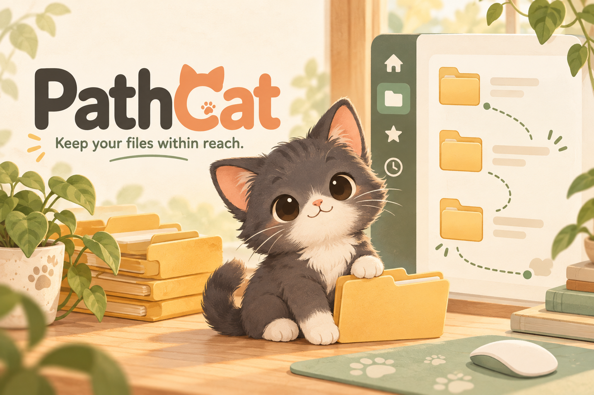
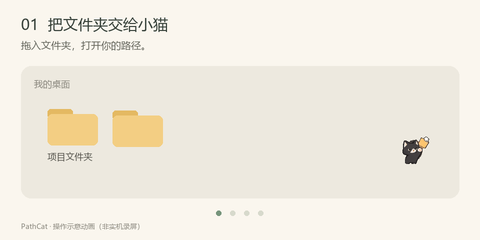

# 🐾 径猫 · PathCat — AI 助手的文件好帮手



<div align="center">

**Cursor、ChatGPT、DeepSeek 工作流里的文件好帮手。**

把文件夹交给它。点一下，打开侧栏；拖一下，整理文件；再点一下，继续专注。

**Windows · 中文 / English · Preview**

[📦 下载 Windows 版](https://github.com/Oxygen-Wang/PathCat/releases) · [🎬 看它怎么用](#-先看小猫怎么帮忙) · [🐾 快速上手](#-把小猫带回桌面)

</div>

**让文件随手可达 · Keep your files within reach.**

径猫是一款 Windows 桌面文件管理工具，帮助使用 **Cursor、ChatGPT、DeepSeek、Claude、Gemini、VS Code** 的你，把代码、文档、图片和参考资料放在手边。
它提供类似 Cursor、VS Code 的文件树与拖拽交互：将文件夹拖到小猫上即可打开路径，在多个目录之间切换、移动或复制文件，让 AI 编程、写作与资料整理更顺手。

PathCat is a lightweight **Windows file manager and desktop file sidebar for AI workflows**.
Keep source code, documents, images, and reference files within reach while working
with **Cursor, ChatGPT, DeepSeek, Claude, Gemini, and VS Code**. Its familiar file
explorer and drag-and-drop experience make it easy to open folders, switch paths,
and move or copy files alongside AI coding assistants and chat tools.

## 🤖 AI 助手的文件好帮手 / A file companion for AI assistants

- **AI 编程 / AI coding**：将项目目录固定在侧栏，快速找到源码、配置和说明文档，方便与 Cursor、VS Code 等编辑器配合使用。
- **AI 对话与写作 / AI chat and writing**：整理准备交给 ChatGPT、DeepSeek、Claude 或 Gemini 的文档、图片和参考资料，减少来回寻找文件的时间。
- **文件拖放 / File drag and drop**：从文件树拖出本地文件，交给支持文件拖放或上传的编辑器、聊天窗口；具体接收方式取决于目标应用。
- **多目录整理 / Multi-folder organization**：在项目、下载、素材和输出目录之间拖动文件，按住 **Ctrl** 复制，整理 AI 工作过程中使用和保存的文件。
- **清爽文件树 / Clean file explorer**：按 `.gitignore`、`.cursorignore` 隐藏无关条目，让常用资料更容易找到。

PathCat 是独立桌面软件，配合你已有的 AI 工具使用；文件上传由目标应用处理。

**相关关键词 / Keywords**：AI 助手文件管理、AI 编程工具、桌面文件侧栏、文件夹拖拽、Windows 文件管理器、Cursor 工作流、ChatGPT 文件整理、DeepSeek 资料管理、AI assistant file manager、AI workflow、desktop sidebar、drag and drop、file explorer、productivity。

## 🎬 先看小猫怎么帮忙



*约 8 秒循环 GIF，无需点击播放。此图为操作示意动画，封面为宣传插画；实际界面以应用为准。*

### 📂 文件夹，交给我吧

把文件夹拖到小猫上，就能打开路径。多个目录变成顶部标签，工作项目、素材和文档都能随手切换。

### 🐈 点一下，文件就在手边

点击小猫，或按 **Ctrl+B**，呼出／收起侧栏。需要时展开，用完收起。

### ✨ 拖过去，整理好

拖动文件到另一条路径标签即可移动；按住 **Ctrl** 拖动就是复制。
悬停标签还能切换目录，继续拖入子文件夹。

### 🎨 给侧栏换件衣服

黑色、白色、暖米色、柔和绿、灰蓝色，五套配色随你选。
支持中文／English 和字体大小调整，偏好会自动保存。

## 🐾 把小猫带回桌面

1. 前往 [Releases](https://github.com/Oxygen-Wang/PathCat/releases)，下载 Windows 发行包并解压。
2. 打开包内的 **PathCat.exe**。
3. 把常用文件夹拖到小猫上，点击小猫或按 **Ctrl+B**，开始整理。

当前为测试版，欢迎通过 [Issues](https://github.com/Oxygen-Wang/PathCat/issues) 反馈问题或想法。
想从源码运行？继续往下看「运行 / Run」。

## 当前版本

**0.2.0-beta.2** · 测试版 / Preview

当前重点是桌面文件管理体验。旧名称 QuietPet、内部 Python 包名及本地设置目录
保留设置升级兼容。Codex 插件、信息工具和本地 MCP 适配已从当前源码删除。

## 🧰 小猫的实用本领 / Features

<details>
<summary>展开查看完整功能与快捷操作</summary>

- 点击小猫或按 **Ctrl+B** 呼出／收起侧栏。
- 默认采用普通窗口层级，点击其他软件后不会持续置顶。
- 拖入文件夹打开路径，多路径标签切换。
- 文件拖到另一条路径标签可移动；悬停 **0.45 秒**切换路径，继续拖入子目录。
- 按住 **Ctrl** 拖动可复制，**Esc** 取消；显示目标路径，同名文件保留两份。
- 支持 Windows 文件拖入和真实文件拖出、复制／剪切／粘贴、重命名与应用回收区。
- 自动读取 `.gitignore`、`.cursorignore`；可编辑规则或临时查看忽略项。
- 中文／English，五套配色，8～20 字体大小，设置自动保存。
- 小猫头顶四步教学。测试版每次启动重播；稳定版完成后不再自动显示。

</details>

## 运行 / Run

需要 Windows、Python **3.10+** 和 tkinter；运行 GUI 不需要安装额外 Python 包。
`.gitignore` 解析依赖已随源码附带，许可证见 [THIRD_PARTY_NOTICES.md](THIRD_PARTY_NOTICES.md)。

```powershell
python PathCat.py
python PathCat.py --version
```

也可以双击 **启动PathCat.bat**。旧的 `QuietPet.py` / `启动QuietPet.bat` 仍可使用。
可执行文件在 [Releases](https://github.com/Oxygen-Wang/PathCat/releases) 中随版本发布，
不提交到源码仓库。发行包提供 SHA-256 校验值。

## 数据与限制 / Data and limitations

- 为保留旧设置，偏好文件仍位于 `%APPDATA%\QuietPet\settings.json`。
- Delete 将内容移入当前目录的 `.quietpet_trash`，目前通过资源管理器恢复。
- 忽略规则只隐藏列表内容，不是访问控制；修改 `.gitignore` 同时影响 Git。
- 大目录复制和跨磁盘移动目前同步执行，可能暂时阻塞界面，暂不支持进度取消和撤销。
- 全局 Ctrl+B 可能与其他程序冲突，可从小猫右键菜单更改。
- 当前只有 Windows 桌面版经过验证。

## 开发与版本 / Development and versioning

```powershell
python tools/check_version.py
python -m unittest discover -s . -p "test_*.py" -v
```

版本号的唯一来源是 [VERSION](VERSION)，变更记录见 [CHANGELOG.md](CHANGELOG.md)。
采用 SemVer；修复升补丁、兼容功能升次版本、不兼容改动升主版本。
所有后续功能通过分支和 PR 合并，版本标签不覆盖、不删除。
详见 [VERSIONING.md](VERSIONING.md)。

## 构建 / Build

```powershell
python -m pip install -r requirements-build.txt
python tools/build_windows.py
```

生成 `dist/PathCat.exe` 和带版本号的 Windows x64 ZIP。只打包桌面应用，
包含运行所需的小猫状态图片、界面图标及第三方许可证与源码。

源码尚未指定项目许可证；第三方库遵循其附带许可证。PathCat 与 Cursor、VS Code 无隶属关系。
